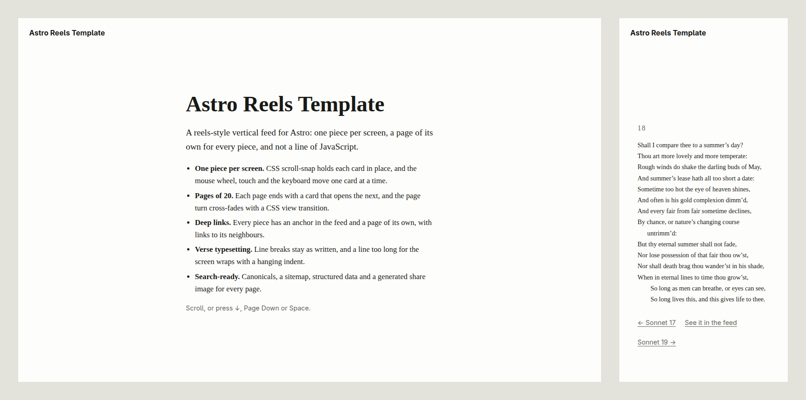

# Astro Reels Template

A reels-style feed of short pieces for [Astro](https://astro.build): one piece per screen, every
piece with its own page, and no JavaScript. The demo is all 154 of Shakespeare's sonnets.



## What you get

- **One piece per screen.** CSS scroll-snap holds each piece in place; the mouse wheel, touch and
  the keyboard (↓, Page Down, Space) move one card at a time.
- **Pages of 20.** `/`, `/page/2/`, … each end with a card that opens the next page, and the page
  change cross-fades with a CSS view transition.
- **Deep links.** Every piece has an anchor in the feed (`/#18`, `/page/2/#25`) and a page of its
  own (`/sonnets/18/`) with links to its neighbours and back into the feed.
- **Verse typesetting.** Line breaks are kept as written. A line too long for the screen wraps
  with a hanging indent, so its remainder never reads as a new line; indented lines (such as a
  sonnet's closing couplet) keep their indent.
- **Search-ready.** Self-referencing canonicals, a sitemap, `robots.txt`, structured data
  (`WebSite`, and `CreativeWork` per piece), Open Graph tags and a generated share image for
  every page. Only the first feed page is indexed until you say the pieces are your own (see
  `indexPieces` below). The 404 page is `noindex`.
- **Accessible and fast.** Light and dark colours checked for contrast by a test, visible focus,
  no web fonts, and off-screen cards skipped by `content-visibility`. Lighthouse scores 100 for
  accessibility, best practices and SEO.

No page ships JavaScript, so the address bar does not follow the scroll and there is no native
share sheet; each piece's own page is the link to share.

## Requirements

- Node.js 24.8.0 or newer
- pnpm 12.3.4, pinned in `package.json`

## Commands

| Command | Purpose |
| --- | --- |
| `pnpm install --frozen-lockfile` | Install dependencies |
| `pnpm dev` | Local dev server |
| `pnpm check` | Astro and TypeScript checks |
| `pnpm build` | Build the static site into `dist/` |
| `pnpm test` | Unit tests, and checks of the last build |
| `pnpm lint:html` | Audit `dist/` with [deadhead](https://deadhead.cevdet.ch) |
| `pnpm verify` | All of the above, in order |

## Make it yours

1. **Site details.** Edit `src/config.ts`: the name, tagline, description, production `origin`,
   the line and credit on the first card, and `feedBase` if the feed should live somewhere other
   than `/`.
2. **Search.** `indexPieces` in `src/config.ts` is `false`, which suits demo text or text that is
   already published elsewhere, such as the sonnets: each piece's page and the feed pages after
   the first carry `<meta name="robots" content="noindex, follow">` and are left out of the
   sitemap, so search engines index only the first feed page but still follow its links. Set it
   to `true` when the pieces are your own, and every page goes into search and the sitemap.
3. **Icons.** Replace the files in `public/`; the share images reuse `public/icon.svg`.
4. **Pieces.** Each piece is a Markdown file in `src/content/sonnets/`:

   ```markdown
   ---
   number: 18
   title: "Sonnet 18"
   description: "Shall I compare thee to a summer’s day?"
   ---

   Shall I compare thee to a summer’s day?
   Thou art more lovely and more temperate:
     So long as men can breathe, or eyes can see,
   ```

   `number` sets the order, `description` (up to 160 characters) is the search snippet, and every
   line of the body is a line on the page. Start a line with two spaces or two em spaces to
   indent it; a blank line starts a new stanza. The body is shown as plain lines, not formatted
   Markdown.
5. **Words.** The section is called `sonnets` in the content folder, `src/content.config.ts`,
   the routes under `src/pages/sonnets/`, `src/lib/sonnets.ts` and `PIECES_PATH` in
   `src/lib/seo.ts`. The share-image label lives in `SECTIONS` in `src/lib/social-card.ts`, and
   the author in the structured data in `src/lib/identity.ts`. Rename them together for your own
   kind of piece.
6. **Page size.** `PAGE_SIZE` in `src/lib/feed.ts`.

## Deploy

`pnpm build` writes a static site to `dist/`. Every URL ends in a slash (`/sonnets/18/`), which
static hosts such as Cloudflare Pages, Netlify and GitHub Pages serve from `index.html` files.
Set `origin` in `src/config.ts` to the production address first: canonicals, the sitemap and
share images use it.

## Acknowledgements

- *Shakespeare's Sonnets* (1609), text from [Project Gutenberg](https://www.gutenberg.org/ebooks/1041),
  imported by `scripts/import-sonnets.mjs`; `scripts/sonnets-source.json` records the file and its
  hash. The sonnets are in the public domain.
- Share images are set in [Noto Sans](https://notofonts.github.io/) (SIL Open Font License, see
  `src/assets/social-fonts/`).
- Built from [`cevdetch/astro-minimal-template`](https://github.com/cevdetch/astro-minimal-template).

## License

The code is MIT licensed; see `LICENSE`.
